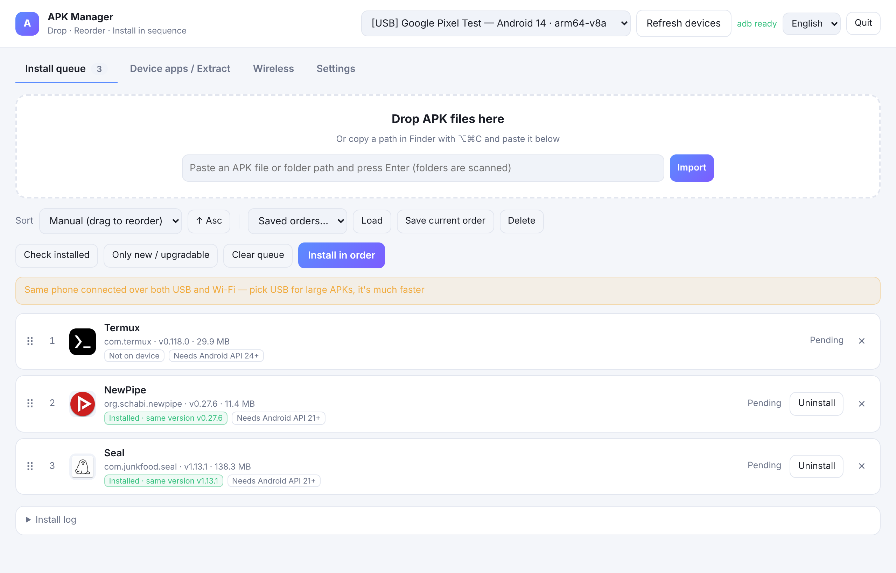
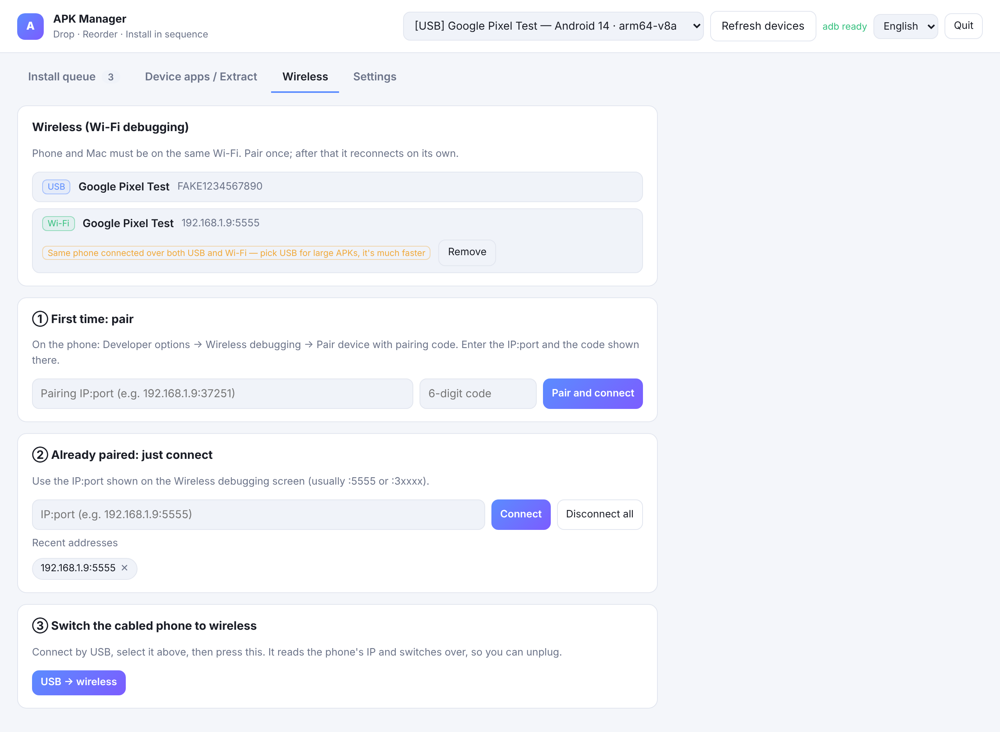
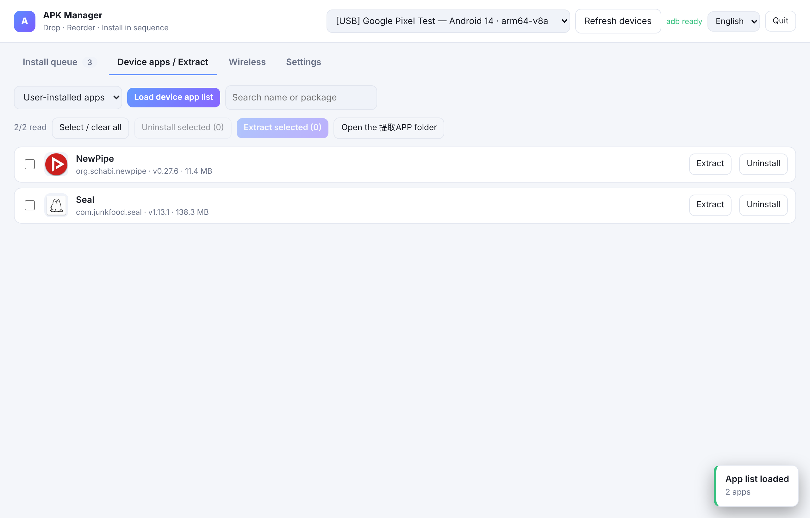
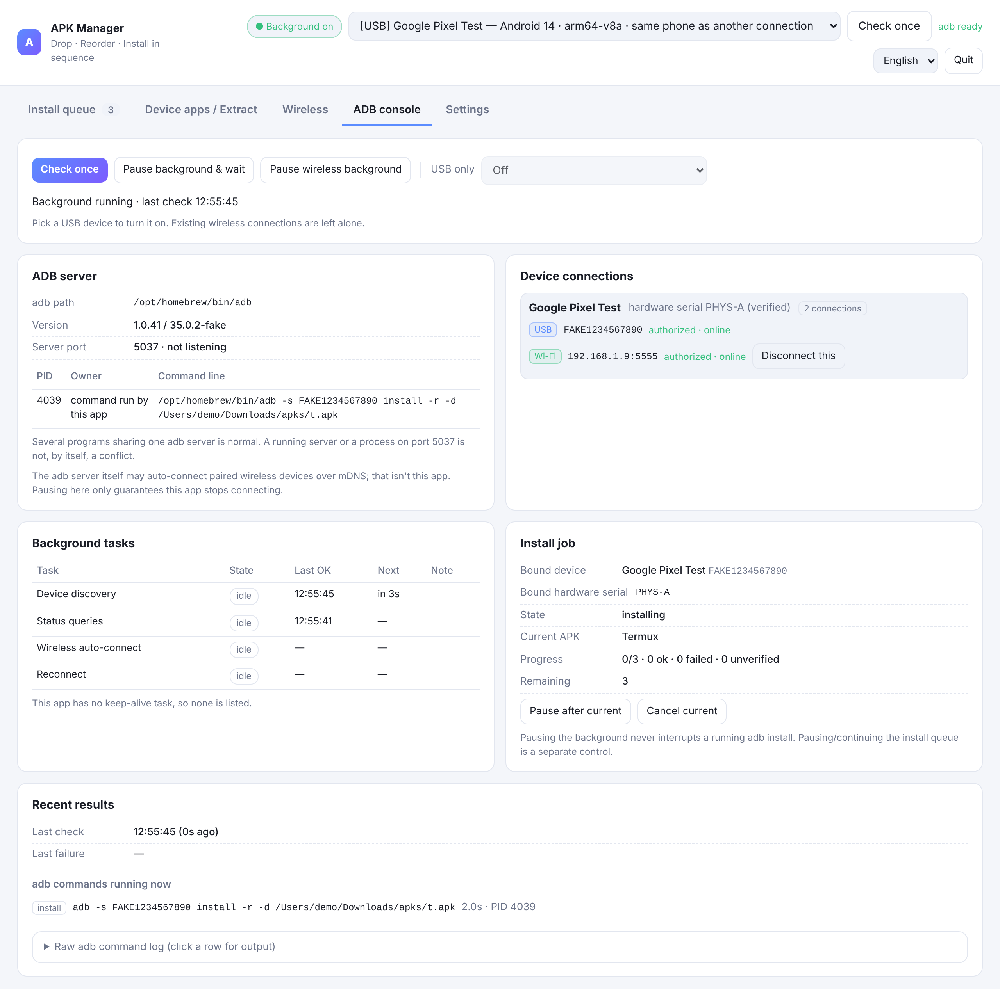

# APK Manager for Mac

**[English](README.md) · [日本語](README.ja.md) · [中文](README.zh-CN.md)**

大量の APK を Android 端末へ、**自分で決めた順番どおり**にインストールするための macOS アプリ。
ドラッグして並べ替えてボタンを押すだけ。別の端末を挿せば同じ順番がそのまま再実行されます。
端末に入っているアプリを**スマホの画面に出る実際の名前**で一覧表示し、APK を取り出すこともできます。

Python 標準ライブラリだけで書かれたローカル Web UI を `.app` に包んだもので、`pip install` も
Node も Xcode も不要です。外部に必要なのは `adb` だけで、それもアプリ内から自動ダウンロードできます。



| ワイヤレス | 端末のアプリ / 抽出 |
| --- | --- |
|  |  |




---

## できること

**インストール待ちリスト**
- APK（フォルダごとでも可）をウインドウにドラッグ。`.apk` / `.xapk` / `.apks` / `.apkm` に対応し、
  分割 APK は自動で `install-multiple` を使います。
- ドラッグで並べ替え。アプリ名・ファイル名・パッケージ名・サイズ・バージョン・追加順でも整列できます。
- **この順番でインストール**：1 件ずつ順に実行し、進捗をその場で表示。各行の**これだけインストール**で 1 件だけ
  入れることもできます。選択中の端末にすでに入っている場合は、その行に**アンインストール**も表示します（先に確認し、
  対象端末も表示）。
- **この 1 件の後で一時停止**で、実行中の APK が終わったところできれいに止まります。**続きをインストール**は
  残りだけを入れます。一部インストール済みの端末に再度インストールするときは「残りだけ／すべて入れ直す」を
  先に確認し、いきなり最初からやり直しません。
- **ケーブルを挿したスマホが自動で対象端末になります。** USB 接続の端末が使える状態になったとき、何も選んで
  いない・Wi-Fi の端末を選んでいる・選んでいた端末が切断済み、のいずれかならその端末に切り替えます（起動時も USB
  優先）。オンラインの別の USB 端末を選んでいるときは奪いません。「USB のみ」モードで、固定した端末がつながって
  いないとき（起動時を含む）は、ケーブルでつながった端末に固定先が自動で移ります。コンソールで選び直す必要はありません。
- 各インストール処理は**1 台の端末に固定**されます（接続先＋確認済みの物理シリアル）。ケーブルが抜けたら
  キューは一時停止し、別の端末を挿しても勝手に再開しません。同じ端末の Wi-Fi 側や別の端末に切り替えることも
  ありません。
- 成功は**端末上で確認**します。`Success` の後、まだ同じ端末かを確かめてから（`pm path` + `dumpsys`）
  パッケージを読み直します。バージョン不一致・パッケージなしは「未確認」。端末に問い合わせできない、または
  端末の識別が確認できない場合（Package Manager 自体のエラーを含む）は**「確認待ち」**のまま、インストールした
  端末との紐付けも残します。問い合わせ失敗を「未インストール」とは表示せず、元の端末に戻せば再インストール
  ではなく確認から始めます。
- 対象端末の識別がまったく確認できない場合（シリアルも信頼できる接続の紐付けもない。例：シリアルを返さない
  Wi-Fi 端末）は、1 件入れたところで止まります。続けるときは 1 件ごとに「続きをインストール」を押します。
  同じアドレスの先が別のスマホに変わっている可能性があるためです。「続き」は次の APK に進みます。直前に入れた
  APK は「未確認」のまま残し、勝手に入れ直しません（入れ直すときは「すべて再インストール」を選びます）。
  同じバージョンでスキップした APK は「1 件」に数えません。
- 並び順に名前を付けて保存（例「新機初期設定」）、次の端末でそのまま読み込み。
- 結果は毎回説明付き。成功ならバージョンと所要時間、失敗なら原因と**対処方法**（署名不一致 →
  先にアンインストール、端末側が新しい → ダウングレードを許可、端末が拒否 → 「USB 経由のインストール」を許可、など）。

**インストール済みの判定**
- 端末を接続すると一覧と照合し、*同じ版* / *旧版（更新可）* / *端末の方が新しい* / *未導入* を表示。
- ボタン 1 つで「未導入・更新可のものだけ」インストール。複数台を仕込むときに便利です。

**端末のアプリ / 抽出**
- インストール済みアプリを**実際の表示名**（日本語名・中国語名もそのまま）とアイコン、
  バージョン、サイズ付きで一覧表示。
- **抽出**を押すと `提取APP/<アプリ名>_<パッケージ名>_<バージョン>/` に APK を保存。
  分割 APK は `base.apk` と全 `split_*.apk` が揃い、`info.txt` も付きます。
- 単体でも一括でもアンインストール可能。データを残す（`-k`）設定もあります。

**ワイヤレス（Wi-Fi デバッグ）**
- Android の「ワイヤレスデバッグ」画面に出る 6 桁コードでペア設定、または既知の `IP:ポート` へ直接接続。
- ボタン 1 つでケーブル接続中の端末をワイヤレス化（`adb tcpip` ＋ IP 自動取得）。先に選ぶ必要はなく、接続（数回まで
  再試行）してワイヤレス側を対象端末にし、アドレスを記憶します。その端末が「USB のみ」のときはオフにしてよいか先に
  確認します。インストール中は実行しません。
- 端末には **USB** / **無線** のラベルが付き、同じ端末が両方でつながっている場合は警告します
  （大きい APK はケーブルの方がかなり速いです）。
- 起動時に前回のワイヤレス端末へ自動再接続。切断された端末への再接続は最大 3 回（5 秒 / 15 秒 / 45 秒）で、
  その後は手動の指示を待ちます。
- 切断は、選んだ `IP:ポート` ひとつだけが対象です。「すべて切断」はありません。

**ADB コンソール**
- 本アプリが端末に対して何をしているかを一か所で確認できます。adb のパス、バージョン、サーバのポート、
  見えている adb プロセス（*本アプリ*／*共有サーバ*／*外部・不明* に分類。サーバが動いている、5037 番ポートが
  使われている、というだけで競合とは表示しません）。
- 端末の接続は**確認済みの物理シリアル**でまとめるので、同じスマホの USB 側と Wi-Fi 側は 1 台として表示されます。
  許可済み・未許可・オフラインも区別して表示します。
- バックグラウンド処理（端末の検出、状態の取得、無線の自動接続、再接続）ごとに、状態（実行中／待機／一時停止／
  終了処理中／失敗で待機）、最終成功、次回実行を表示。
- インストール処理、直近の失敗、いま実行中の adb コマンド、コマンドの生ログ。
- 操作：**1 回だけ確認**、**バックグラウンドを止めて待機／再開**、**無線バックグラウンドを停止**、**USB のみ**
  （インストールはその USB 端末だけ。その端末への無線検索・再接続・`tcpip` は行わず、USB が外れたらキューを停止）。

**「バックグラウンドを止めて待機」**は、本アプリが端末に触れるのを止める操作です。インストール中の APK は
最後まで実行しますが、その後の問い合わせはせず（adb の終了コードと出力を保持したまま「確認待ち」にします）、
次の APK は始めません。**「再開」**は確認待ちを先に確認し、インストールを勝手に再開しません。結果が不明というだけで
再インストールすることもありません。**「実行中を取り消す」**は本アプリ自身の `adb install` プロセス（PID 指定）だけに
シグナルを送り、その後端末を確認します。確認できなければ「取り消し済み・未インストール」ではなく「不明」と表示します。
一時停止の操作が返った時点で、キューや確認のための新しい adb コマンドは一切起動せず、停止後に返ってきた結果も
書き込みません。

自動で行う adb 処理はすべてバックエンドの**スケジューラスレッド 1 本**で実行されます。ページを再読み込みしても、
ウインドウを 2 つ開いても、「再開」を連打しても、ループが増えることはありません。一時停止の状態はバックエンドが
持っているので、再読み込みで勝手に再開しません。`adb kill-server` は実行せず、本アプリが起動していないプロセスを
終了させることもありません。

**3 言語対応** — 日本語・English・中文。右上で切り替えでき、macOS の通知文もそれに追従します。

---

## インストール

1. [Releases](../../releases) から `APK-Manager-mac.zip` をダウンロードして展開します。
2. **APK Manager.app** を好きな場所（アプリケーションフォルダなど）に移動します。
3. **初回は右クリック →「開く」→「開く」** が必要です。未署名アプリは普通のダブルクリックでは
   macOS に止められます。チェックごと外すなら:
   ```bash
   xattr -dr com.apple.quarantine "/Applications/APK Manager.app"
   ```
4. ウインドウを閉じれば終了します（約 25 秒後。インストール中は終了しません）。

**Python 3.8 以上**が必要です。macOS 単体には使える Python は入っていません。`/usr/bin/python3` は Xcode
コマンドラインツール（`xcode-select --install`、現在は 3.9 が入ります）を入れるまでは中身のない入口です。Homebrew
（`brew install python`）や python.org のインストーラでも構いません。起動スクリプトはこれらを絶対パスで探し
（Finder から起動したアプリにはターミナルの `PATH` が渡らないため）、見つからなければ案内を表示します。
実機の Mac ではまだ検証していません。[受け入れチェックリスト](docs/MAC_ACCEPTANCE.md)と
`tools/mac_diagnose.sh`（読み取り専用の診断）を参照してください。

同時に動くのは 1 つだけです（ロックファイルで判定。もう一度ダブルクリックするとウインドウが開き直すだけ）。
古いバージョンが動いていて「待機中」と報告した場合だけ、終了させて新しい版に交代します。作業中（インストール・
アプリ一覧の読み込み・APK 抽出）の場合や、抽出状態を報告できない 1.5.2 より前の版の場合はそのまま残し、macOS では
自分で終了するよう案内を出します。ウインドウを閉じたときも「終了」を押したときも、これらの作業中は待ちます。

### スマホ側の準備（初回のみ）

1. 設定 → 端末情報 → **ビルド番号**を 7 回タップ。
2. 設定 → 開発者向けオプション → **USB デバッグ**を有効化（Xiaomi 系は **USB 経由のインストール**も）。
3. ケーブルで接続し、スマホ側の確認ダイアログで**許可**をタップ。

`adb` が入っていない場合は、**設定 → adb を自動ダウンロード**から Google 公式の platform-tools を取得できます。

---

## ソースから動かす

```bash
git clone https://github.com/NegiGao/apk-manager-for-mac.git
cd apk-manager-for-mac
python3 app.py            # ブラウザで http://127.0.0.1:8777 が開きます
```

`.app` を自分でビルドする場合（アイコン生成込み、追加ツール不要）:

```bash
python3 tools/build_app.py     # → build/APK Manager.app
```

---

## 仕組み

| ファイル | 役割 |
| --- | --- |
| `core/binxml.py` | Android のバイナリ XML と `resources.arsc` のパーサ（自前実装、`aapt` 不要） |
| `core/apkinfo.py` | パッケージ名・バージョン・**実際のアプリ名**・アイコン、`.xapk`/`.apks` 対応 |
| `core/adbkit.py` | adb ラッパー：端末一覧、インストール、ペア設定／接続、リモート APK の部分読み出し |
| `core/supervisor.py` | 自動で行う adb 処理の唯一のスケジューラ：一時停止／再開、USB のみ、回数制限付きの再試行 |
| `core/engine.py` | 待ちリスト、並び順プリセット、インストール実行（端末固定・停止の境界・結果確認）、導入済み判定、アンインストール、抽出 |
| `core/server.py` | ローカル HTTP + SSE サーバ（`127.0.0.1` のみ待ち受け） |
| `web/` | UI（素の JavaScript）と多言語テーブル |

特に工夫した点をいくつか挙げます。

**APK 全体を転送せずに実際のアプリ名を読む。** 端末上の APK を丸ごとコピーすると数十 GB になり得ます。
そこで、まずリモート APK の ZIP セントラルディレクトリを読み、`AndroidManifest.xml` と
`resources.arsc` **だけ**を `adb exec-out` 経由の `tail`/`head` で取得し、ローカルで解析して
UI 言語に合うラベルを選びます。結果はパッケージ単位でキャッシュされます。

**遅れて届いた結果で一時停止を上書きしない。** 一時停止するたびに世代番号を進めます。停止の時点で動いていた
処理は「終了処理中」と表示し、戻ってきた結果は世代が変わっていれば破棄します。遅い `adb devices` が古い情報を
「リアルタイム」として描き直したり、すでに切り替えた端末に状態が反映されたりすることはありません。

**起動経路から重い処理を外した。** ランチャーは Python を `exec` するだけで、ポートを選ぶためだけの
2 個目のインタプリタ起動をなくしました。Python はサーバのモジュールを読み込む**前に**ソケットを
bind してブラウザを起動するので、ブラウザのコールドスタートと import が並行して進みます。
バイトコードは bundle に事前コンパイル済み（/Applications 内の `.app` は `__pycache__` を書けないため、
そうしないと毎回コンパイルが走ります）。adb デーモンは別スレッドで暖機し、使ったブラウザは次回のために
記憶します。起動済みのときに再度開くと、既存のインスタンスを再利用します。

---

## テスト

実機は不要です。`tests/fakeadb/adb` は、ケーブルの抜け、未許可・オフラインの端末、同じ Wi-Fi アドレスの先が
別のスマホに変わる、再接続の失敗、インストール途中の中断、`Success` と言いつつ実際には入っていない、といった
状況を再現する代用 adb です。

```bash
sh tests/get_test_apks.sh        # 初回のみ：オープンソースの実 APK を 3 つ tests/apks/ に取得
python3 tests/acceptance.py      # 全シナリオ（約 10 分）。失敗があれば終了コードは 0 以外
python3 tests/acceptance.py 10 13  # 一部だけ
APKMGR_TEST_SERVER_PY=/path/to/python3.9 python3 tests/acceptance.py   # アプリを 3.9 で動かす
APKMGR_TEST_EVIDENCE=./evidence python3 tests/acceptance.py            # adb コマンド記録を残す
python3 tests/delivery_check.py --zip APK-Manager-mac-v1.5.7.zip --py39 /path/to/python3.9
python3 tests/diag_check.py      # 診断スクリプトが実行する adb は `adb version` だけであることを確認
python3 tests/ui_check.py        # ヘッドレス Chromium：バージョン／制作者表示と各行のボタン
APKMGR_TEST_CODE=/path/to/old/checkout python3 tests/acceptance.py 17   # 同じテストを旧コードで実行
```

`acceptance.py` の対象：USB インストール中の無線バックグラウンド停止、再接続失敗中の一時停止、ウインドウ数や
「再開」連打に関係なくスケジューラが 1 つ、同じ端末の USB／Wi-Fi 同時接続、インストール中のケーブル抜け、未許可・
オフライン・接続失敗・一時停止の区別、他の adb 利用者に手を出さない、端末上でのインストール確認、キューの停止の境界、
インストール中のバックグラウンド停止（確認待ち・再インストールしない）、遅れて届いた結果を書き込み前に破棄、同じ端末に
限定した確認、本アプリのプロセスだけを取り消す、同時起動・旧版からの更新でも 1 インスタンス、停止中は adb 通信なし、
「1 回だけ確認」が本当に 1 回だけ。v1.5.2 で追加：識別確認中・確認中に一時停止した場合、端末が入れ替わっても
確認待ちが消えないこと、Package Manager のエラー、識別できない端末、抽出中も「作業中」と扱うこと。競合のタイミングは
代用 adb の「バリア」（指定した位置でコマンドを止め、テストが解放するまで待たせる）で固定しており、繰り返し実行や
sleep 頼みではありません。`delivery_check.py` はリリース ZIP を日本語・空白入りのパスに展開し、Finder に
近い最小環境、読み取り専用のバンドル、Python 3.9、インストール中の強制終了、v1.4／v1.5.0 のデータで起動を確認します。

---

## プライバシー

すべて自分の Mac 上で動き、`127.0.0.1` のみに待ち受けます。どこにも何も送信しません。
外部通信は Google から platform-tools を取得するときだけで、それもボタンを押したときに限ります。

データは `~/Library/Application Support/APK安装管家/`（待ちリスト、並び順、設定、アイコンキャッシュ）、
ログは `~/Library/Logs/` にあります。アプリとこの 2 つを削除すれば跡形なく消えます。

---

## よくある質問

**「端末が見つかりません」と出る。** データ転送対応のケーブルを使い、別のポートを試し、スマホ側で
「許可」をタップしたか確認してから「端末を再検出」を押してください。

**インストールが止まったように見える。** たいていはスマホ側に確認ダイアログが出ています。画面のロックを
解除してください。メーカーによっては開発者向けオプションの「USB 経由のインストール」が必要です。

**アプリ一覧の読み込みが遅い。** 初回は全アプリの情報を読むため、数百件で数分かかります。以降はキャッシュが
効きます。「ユーザーが入れたアプリ」は「すべて」よりずっと速いです。

**無線バックグラウンドを止めたのに無線接続が現れる。** 停止が保証するのは「本アプリが接続しない」ことだけです。
他のソフトが端末を接続することもあれば、adb サーバ自身が以前ペアリングした端末に自動接続することもあります。
コンソールは本アプリが接続したかどうかは判別できます。そうでない場合は「本アプリが接続したものではありません
（接続元は不明）」と表示し、それ以上の推測はしません。共有の adb サーバを再起動したり設定を変えたりはしません。

**アンインストールできないアプリがある。** プリインストールのシステムアプリはこの方法では削除できません。
その場合はアプリがそう表示します。

---

## 制作者 / ライセンス

制作：**NegiGao** — https://github.com/NegiGao/apk-manager-for-mac（バージョンとこのアドレスはアプリ上部と
「設定 → このアプリについて」にも表示されます）。

MIT — [LICENSE](LICENSE) を参照してください。
